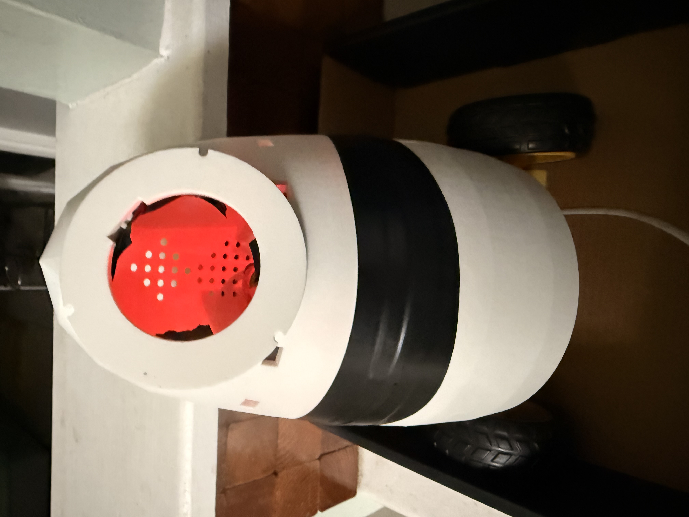

# Nobi: development reference

Updated November 9, 2026.

Nobi is Devin Roberts' desk-companion robot project in development. The current full-size design is based on Raspberry Pi 4. Final hardware configuration, fit and complete-build testing still need verification.

## Early prototype photograph

Early Nobi prototype, July 2026. The face opening is incomplete and the display is not installed. This historical photograph does not show the current finished hardware or establish what is offered for purchase.

Courtesy of Devin Roberts.

## Project links

- [Nobi Workshop Log](https://developmentindustries.org/blog): development history and project context.
- [Nobi on Etsy](https://nobibot.etsy.com/listing/4578776218): the maker's commercial project listing. Check the listing for current sale details and terms.
- [Try Nobi’s animated face](https://developmentindustries.org/#top): tap Nobi or choose an eye colour. This is a browser visualization of expressions, not a demonstration of finished hardware or owner-authenticated conversation.
